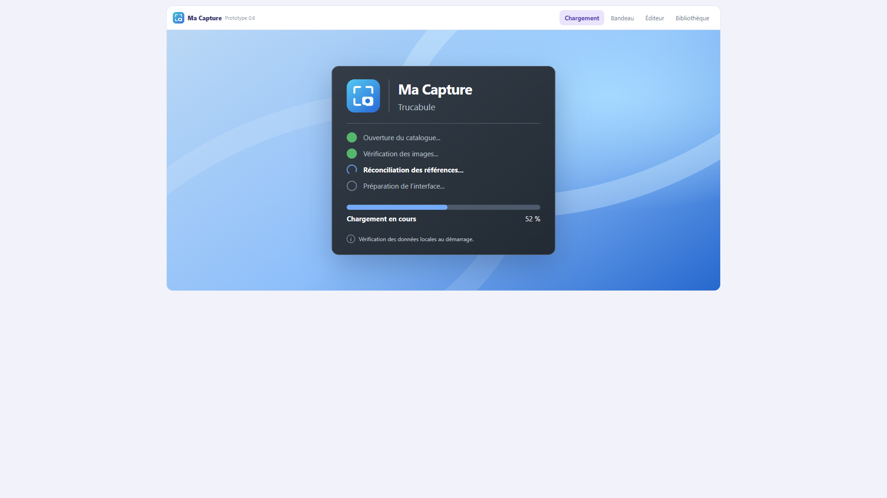
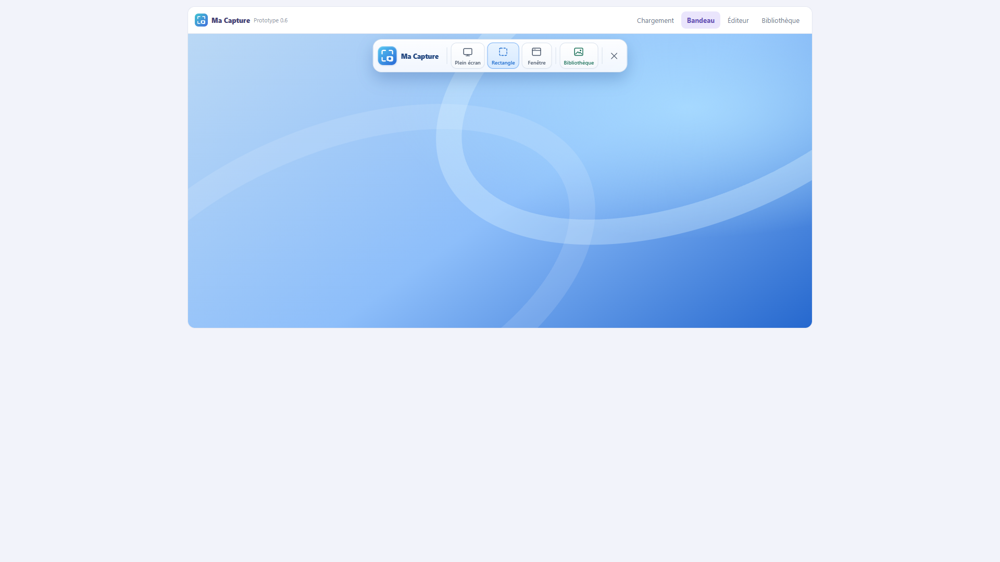
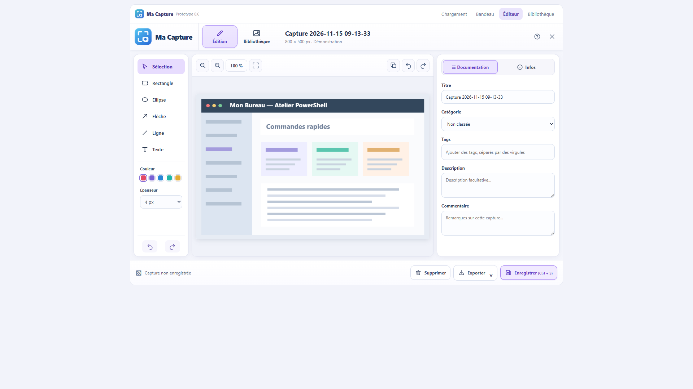
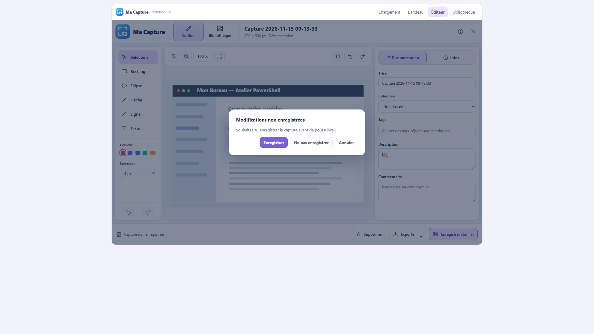
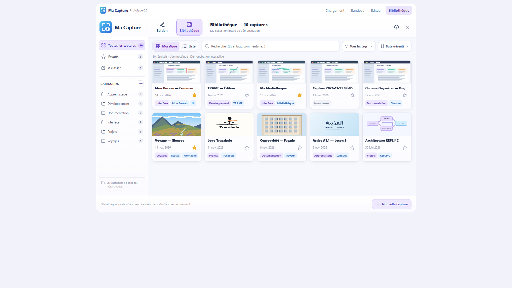
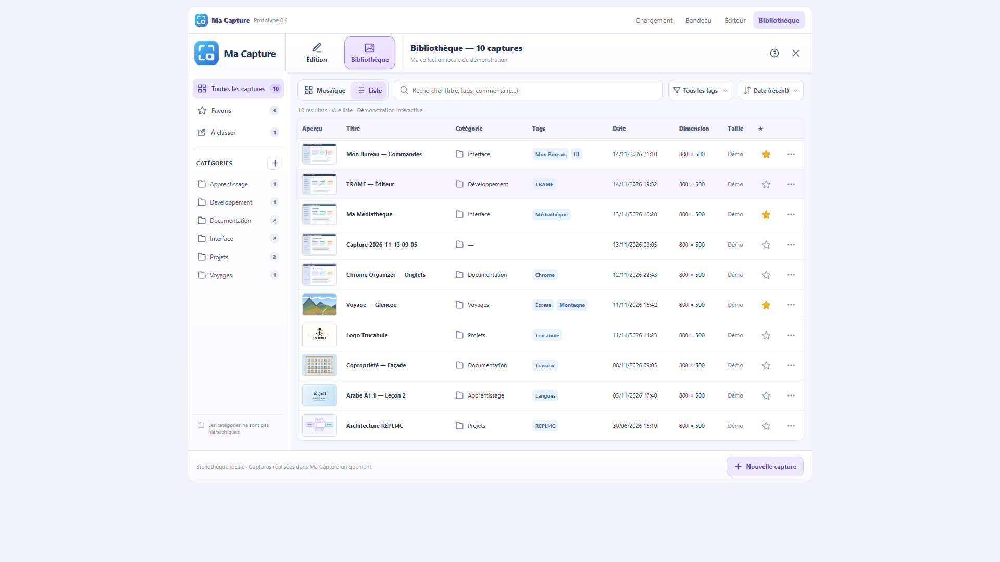

# Ma Capture — Guide des écrans pour Codex

**Statut : référence graphique de conception validée ; guide harmonisé le 15 novembre 2026. Aucune mission Codex lancée.**  
**Emplacement :** `docs/graphisme/guide-des-ecrans-ma-capture.md`  
**Références fonctionnelles :** `docs/conception/001` à `005`, ainsi que le registre des arbitrages.  
**Public :** équipe de réalisation / Codex, une fois les consignes approuvées.

## 0. Comment utiliser ces maquettes

**Référence interactive principale :** [ma-capture-prototype.html](ma-capture-prototype.html). C'est la cible graphique et ergonomique : proportions, composants, navigation et gestes. Son JavaScript simule des captures ; il **n'est pas à recopier comme moteur natif Windows**.

Les **six PNG** ci-dessous sont des prises de vue du **même prototype**, et non des maquettes graphiques concurrentes :

| Réf. | Capture PNG | Usage |
|---|---|---|
| G-01 | [01-splash.png](01-splash.png) | Démarrage et chargement |
| G-02 | [02-bandeau.png](02-bandeau.png) | Petit bandeau flottant |
| G-03 | [03-editeur.png](03-editeur.png) | Éditeur et fiche documentaire |
| G-03P | [03-editeur-popup.png](03-editeur-popup.png) | **Style des dialogues et popups** |
| G-04 | [04-bibliotheque-mosaique.png](04-bibliotheque-mosaique.png) | Bibliothèque mosaïque |
| G-05 | [05-bibliotheque-liste.png](05-bibliotheque-liste.png) | Bibliothèque liste |

**Hiérarchie pour Codex :** les documents [001 à 005](../conception/001-vision-et-perimetre.md) fixent **les fonctions et les données** ; le HTML fixe le **design interactif** ; les PNG sont les **états visuels vérifiables**. Si le prototype présente un contrôle de démonstration ou une interaction ne figurant pas dans les exigences, **ne pas en déduire une nouvelle fonctionnalité**. Les captures fictives, nombres, titres, dates, décors et contrôles de navigation du simulateur ne doivent pas devenir des données de production.

### Ligne graphique commune

- Application Windows contemporaine, sobre et lisible ; grandes zones aérées, angles légèrement arrondis, icônes simples, contrastes suffisants.
- Splash screen volontairement **anthracite avec accents bleus**, conformément à la maquette G-01.
- Bandeau, éditeur et bibliothèque dans le **thème clair bleuté** visible sur G-02 à G-05, avec touches **violet doux / bleu / turquoise**. Respecter les **variations effectivement validées** entre les écrans au lieu d'en inventer une uniformisation.
- Le fond bleu de Windows et les photographies servent à **mettre en situation** les écrans, pas à devenir un fond imposé de l'application ni des ressources à importer en bibliothèque.
- Les dimensions de la maquette sont une **intention de proportions**, pas une obligation de calquer des pixels sur une résolution donnée.

## 1. G-01 — Splash screen / chargement



### Apparence

- Petite fenêtre de démarrage centrée, panneau anthracite sombre, coins arrondis, ombre douce.
- Logo de capture en bleu à gauche ; nom **Ma Capture** et signature **Trucabule**.
- Indicateurs simples pour les étapes : ouverture du catalogue, vérification des images, réconciliation des références, préparation de l'interface.
- Barre de progression et état lisible, sans surcharge de messages techniques.

### Comportement

1. Apparaît au lancement de l'application, avant le bandeau de capture.
2. Ouvre `catalogue.db` et `images.db` ; vérifie les références d'images **sans charger tous les BLOB** ; préserve les données provisoires récupérables et supprime silencieusement les orphelins ordinaires selon les documents 003/004.
3. Prépare l'interface puis disparaît automatiquement. Si les vérifications sont immédiates, **ne pas ralentir artificiellement le lancement** pour montrer une animation ou un pourcentage.
4. Si une session interrompue est récupérable, la montrer ensuite **dans l'éditeur, image visible**, avec **Enregistrer / Ne pas enregistrer / Annuler**.
5. Une erreur empêchant le démarrage doit être compréhensible ; la suppression d'orphelins ordinaires ne déclenche ni alerte ni rapport visible.

**Attention :** le « ~70 % » de la maquette est une illustration, **pas une valeur fixe**. Pas de moteur de réparation élaboré ni de parcours de configuration.

## 2. G-02 — Bandeau flottant de capture



### Apparence

- **Petit bandeau horizontal**, posé **en haut et au centre de l'écran**, pas une grande fenêtre d'accueil.
- Coins arrondis, fond clair légèrement translucide, ombre discrète, **logo identique au splash** à gauche. Dimensions compactes, conformes à G-02 : pas de gros panneau d'accueil.
- Cinq commandes lisibles : **Plein écran**, **Rectangle** (sélectionné par défaut), **Fenêtre**, **Bibliothèque** et **croix seule**, sans texte « Fermer ».
- La commande sélectionnée se distingue par un bleu doux, comme sur la maquette.

### Comportement

- **Plein écran** : capture l'écran choisi par le fonctionnement normal de V0 ; aucune gestion multimoniteur avancée demandée.
- **Rectangle** : commence la sélection rectangulaire à la souris ; mode initial après lancement.
- **Fenêtre** : permet de désigner une fenêtre à capturer.
- **Bibliothèque** : ouvre la bibliothèque documentaire, sans créer de capture.
- **Fermer** : ferme l'application, après protection éventuelle du travail non enregistré.
- Pendant la sélection/capture, le bandeau **ne doit pas figurer dans l'image capturée**. Si la capture est annulée, aucune fiche vide n'est créée.
- Après une capture réussie, afficher **directement l'éditeur** (G-03).

### Raccourci clavier global

- Un **raccourci global distinct du `Win + Maj + S` de Windows** est souhaité pour Ma Capture, afin de laisser le choix entre les deux outils.
- **Combinaison V0 validée : `Ctrl + Alt + C`**, testée comme non occupée sur Zenith Ice par l'utilisateur ; la disponibilité devra être gérée au lancement. Ne pas prendre possession de `Win + Maj + S` ni écraser le raccourci d'une autre application.
- **V2 seulement :** permettre à l'utilisateur de personnaliser ce raccourci dans les paramètres.
- Ceci est distinct de **Ctrl + S** dans l'éditeur, qui sauvegarde la capture.

## 3. G-03 — Éditeur / annotation et documentation



### Apparence et disposition

- Fenêtre principale organisée en **trois zones** : palette d'outils **libellés** à gauche, **grande image éditable** au centre et **fiche documentaire** à droite ; logo commun au splash, au bandeau et à la bibliothèque.
- En haut : identification Ma Capture, accès Édition/Bibliothèque, titre et quelques outils de navigation/zoom.
- En bas : état de sauvegarde, commande d'export et **un seul bouton Enregistrer (Ctrl + S)**. Le panneau documentaire est redimensionnable.
- Garder le style validé de la maquette : fond clair, contours fins, accent violet pour les actions sélectionnées, champs lisibles.

### Édition de l'image

- La capture est **directement modifiable dès son apparition**, sans autre fenêtre ni mode spécial.
- Outils **dans la V0** : **Sélection**, **Ligne/Trait**, **Flèche**, **Rectangle**, **Ellipse**, **Texte**, couleur et épaisseur ; **Annuler/Rétablir** sur la séance.
- Formes de mise en évidence : **contours colorés, intérieur entièrement transparent**. Les annotations restent sélectionnables, déplaçables, redimensionnables et recolorables.
- **Zoom à la molette, 100 %, adapter à la fenêtre** ; les annotations suivent les coordonnées de l'original.
- L'image originale est immuable : annotations courantes conservées en JSON, dans `Captures`, sans versionnage permanent.

### Fiche documentaire

- Affichée **en permanence à droite** (repli/redimensionnement envisageables en recette) : **Titre prérempli automatiquement**, **date/heure de capture en lecture seule**, **Description**, **Commentaire**, **0 ou 1 catégorie**, **plusieurs tags**.
- Tous les enrichissements sont **facultatifs** : cliquer simplement sur Enregistrer conserve la capture avec son titre proposé.
- Rouvrir une capture de la bibliothèque ramène dans **le même éditeur**, avec annotations et champs encore modifiables.

### Actions principales

- **Enregistrer / Ctrl + S** : conserver la capture et la fiche ; confirmation discrète, sans formulaire bloquant.
- **Exporter PNG/JPEG** ou **Copier vers le presse-papiers** : rendre **l'état affiché**, même non enregistré, **sans sauvegarder implicitement** dans la bibliothèque ; aucun suivi des fichiers exportés.
- **Naviguer, demander une autre capture ou quitter avec des modifications non sauvegardées** : montrer l'image avec le dialogue **Enregistrer / Ne pas enregistrer / Annuler** ; les trois choix restent distincts.
- **Suppression volontaire d'une capture archivée** : confirmation préalable. Ne pas confondre cette action avec « supprimer l'annotation sélectionnée ».

### Simulation et fonctionnalités hors V0

Le HTML présente des **captures fictives**, des titres d'exemple et quelques commandes propres à la démonstration. Ne pas implémenter Flou, Masque, retouche photographique, recadrage complexe, calques ou import d'images. Les seules annotations V0 sont Sélection, Ligne, Flèche, Rectangle, Ellipse et Texte, avec couleur, épaisseur et édition.

## 3 bis. G-03P — Référence graphique des dialogues et popups



**Cette capture fait référence pour le STYLE des dialogues applicatifs.** Les dialogues de confirmation, de perte potentielle et de récupération doivent appartenir à la même famille graphique que l'éditeur : bordures, arrondis, typographie, espacements, contraste, disposition et hiérarchie des boutons. **Ne pas laisser les popups applicatives dans un style Windows brut incohérent par défaut.**

Les comportements demeurent ceux des documents 002/004/005 :
- Travail non enregistré : **Enregistrer / Ne pas enregistrer / Annuler**, trois conséquences distinctes.
- Suppression volontaire : confirmation explicite.
- Récupération : image visible et choix sans effacement sur Annuler.
- Erreur : message compréhensible, sans succès fictif.

Le PNG G-03P ne crée **aucune nouvelle commande métier**. Les dialogues standards de choix de fichier (export ZIP, fichiers) peuvent rester natifs Windows ; c'est le style des **popups propres à Ma Capture** qui doit être reproduit.

## 4. G-04 — Bibliothèque : mosaïque



### Apparence

- Fenêtre Bibliothèque du même univers clair violet/bleu que l'éditeur.
- Navigation à gauche : **Toutes les captures**, **Favoris**, **À classer** et catégories **simples**, sans hiérarchie artificielle.
- Haut : bascule **Mosaïque / Liste**, champ de recherche, filtre tags, tri.
- Corps : cartes rectangulaires avec **miniature annotée**, titre, date, catégorie éventuelle et tags affichés sans surcharge.

### Comportement

- Le mode mosaïque et le mode liste sont **deux présentations du même catalogue**, pas deux collections de données.
- Les miniatures montrent **les annotations du dernier enregistrement**, pas les modifications en cours non enregistrées dans l'éditeur.
- Double-clic ou ouverture de carte : rouvrir l'éditeur G-03 avec la fiche et les annotations modifiables.
- Recherche sur titre, description, commentaire ; filtres catégorie/tags ; tri date ou titre ; **À classer = aucune catégorie**.
- Un utilisateur peut créer une catégorie/un tag depuis la fiche, avec une gestion simple depuis la bibliothèque.

### Visuels purement illustratifs

- Les vignettes montrent des **exemples de contenus capturés**, pas une fonction d'import de photos, PDF ou autres images.
- Les chiffres des compteurs et exemples de catégories sont des **données fictives**.
- Les **étoiles Favoris sont validées pour V0** (bascule unitaire, filtre accessible en mosaïque et liste). **La sélection multiple et les opérations de masse sont reportées** : toute case de sélection multiple issue d'une ancienne maquette est un défaut d'illustration.

## 5. G-05 — Bibliothèque : liste



### Apparence

- Même entête, même navigation et mêmes filtres que la mosaïque : seule **la présentation centrale** change.
- Table lisible : petite miniature, **Titre**, **Catégorie**, **Tags**, **Date**, **Dimensions**, **Taille**. Les colonnes secondaires peuvent être ajustées en recette.
- Ligne sélectionnée mise en évidence avec une nuance violette très légère ; tri visible dans les en-têtes concernés.

### Comportement

- Une capture sélectionnée est la même que dans la mosaïque ; ouverture dans l'éditeur G-03.
- Recherche et filtres partagés avec la mosaïque, sans modification des données lors du changement de vue.
- Renommer/reclasser passe par la fiche documentaire ; la suppression volontaire passe par une **confirmation**.
- **Étoiles Favoris opérationnelles**, identiques à la mosaïque. **Pas de cases de sélection multiple ni d'actions de masse en V0** ; si de tels éléments apparaissent dans une image illustrative, les ignorer. Les menus par capture n'ajoutent que des actions déjà autorisées.

## 6. Parcours complet entre les écrans


```text
Démarrer Ma Capture
        ↓
G-01 — Splash / vérification des données
        ├── Travail provisoire récupérable ? → G-03 + dialogue de reprise
        └── Sinon → G-02 — Bandeau flottant en haut
                      ├── Plein écran / Rectangle / Fenêtre → G-03 — Éditeur
                      │                                      ├── Enregistrer → capture archivée, éditeur disponible
                      │                                      ├── Exporter / Copier → rendu de l'état visible
                      │                                      └── Modifier / reclasser → même écran
                      ├── Bibliothèque → G-04 Mosaïque ⇄ G-05 Liste
                      │                       └── Ouvrir capture → G-03
                      └── Fermer → Quitter
```

La nouvelle capture doit être accessible de manière simple après un enregistrement, sans système de « capture en rafale » ni deuxième bouton de sauvegarde.

## 7. Règles de réalisation et recette graphique

1. **Fidélité aux maquettes validées**, sans chercher à transformer une illustration en liste de nouvelles fonctionnalités.
2. **Même composants et navigation** entre Bibliothèque mosaïque/liste ; **même éditeur** lors de la création ou de la réouverture.
3. **Proportions souples** : image prioritaire dans l'éditeur, panneau documentaire utilisable, aucun champ essentiel masqué.
4. **États réels** : vide, capture non enregistrée, capture enregistrée, annotation sélectionnée, erreur d'enregistrement, récupération après plantage.
5. **Vérification manuelle sur Windows** : splash court, bandeau haut centré, prise de vue qui ne capture pas le bandeau, outils d'annotation utilisables, écran de bibliothèque clair et cohérent dans les deux vues.
6. **Pas de modification automatique de la spécification** pour « embellir » ou « enrichir » l'interface ; les désaccords entre illustration et périmètre sont remontés pour arbitrage.

## 8. Décisions finales et limites de réalisation

- **Raccourci global V0 :** `Ctrl + Alt + C`, distinct de `Win + Maj + S`. En V2, rendre la combinaison modifiable par l'utilisateur.
- **Favoris V0 :** un booléen par capture, étoile et filtre rapide dans les deux vues de bibliothèque.
- **Sélection multiple :** **hors V0**, même si une image de référence ancienne montre des cases à cocher. Pas d'opération en lot.
- **Popups :** traiter la capture G-03P comme référence de style et préserver exactement les comportements métier.
- **Autres outils :** Flou, Masque, calques, retouche avancée et import d'images exclus.
- **Un seul logo** pour les différents écrans : celui du splash. Le fond bleu du bureau sur le PNG ne doit pas être incrusté comme fond fixe dans l'application.
- **Aucune référence au numéro de version du simulateur** ne doit devenir le nom du produit ou apparaître comme élément permanent de la V0.

**Étape suivante :** découper les missions Codex après validation documentaire. Ce guide est une référence ; sa publication ne lance aucun développement.
